# Synthetica Health — Frontend SSR con React, Next.js y TypeScript

**Dashboard SaaS B2B de inteligencia operativa para clínicas** · React 18 · Next.js 14 (SSR, App Router) · TypeScript estricto · Tailwind CSS · SCSS · TanStack Query (React Query) · Zustand · GraphQL · APIs REST · Recharts · Jest · React Testing Library · Playwright · Storybook · Design System · Accesibilidad WCAG 2.1 AA · Node.js · Express · PostgreSQL (Supabase)

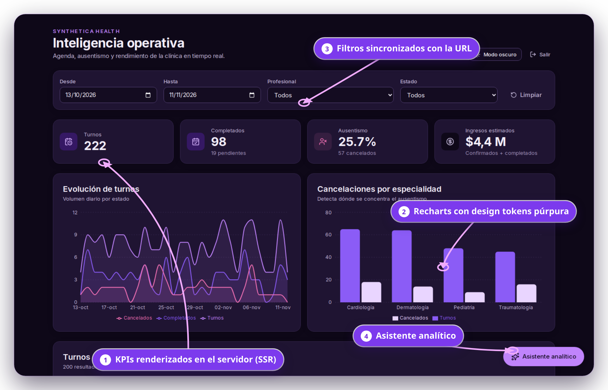

| Problema | Solución | Impacto objetivo |
|---|---|---|
| Las clínicas medianas pierden hasta un **35%** de sus ingresos por ausentismo y mala asignación de turnos | Dashboard en tiempo real, renderizado en servidor, con filtros avanzados, design system propio y asistente analítico en lenguaje natural | **−30%** tiempo administrativo · **+22%** recuperación de pacientes |

**Demo local:** `cd client && npm install && npm run dev` → http://localhost:3000 · usuario `demo@synthetica.health` / `demo1234`

---

## Requisitos del puesto → dónde está cada uno

| Requisito | Implementación | Evidencia |
|---|---|---|
| **React en producción** | React 18 con componentes funcionales, hooks y composición | `client/src/features`, `client/src/components/ui` |
| **SSR (Server-Side Rendering)** | Next.js 14 App Router: `/dashboard` es un Server Component que precarga datos e hidrata TanStack Query | `client/src/app/dashboard/page.tsx` · test E2E "SSR: el HTML inicial ya trae los KPIs" |
| **TypeScript** | `strict`, `noUncheckedIndexedAccess`, `exactOptionalPropertyTypes`; contratos compartidos con la API | `client/tsconfig.json`, `client/src/types/analytics.ts` |
| **HTML5 / CSS3 / SCSS** | HTML semántico (`main`, `section`, `table` con `caption` y `scope`), variables CSS, SCSS Modules con mixins y `@use` | `client/src/index.css`, `client/src/styles/_mixins.scss`, `Skeleton.module.scss` |
| **Tailwind CSS** | Design tokens propios (colores, tipografía, espaciado, radios, sombras) mapeados a Tailwind | `client/tailwind.config.js` |
| **APIs REST** | API Express (auth, analytics, asistente) + BFF REST en Next | `server/routes`, `client/src/app/api/bff` |
| **GraphQL** | Endpoint `/api/graphql` con schema tipado, enums, inputs y validación; el dashboard consulta por GraphQL | `client/src/server/graphql`, `client/src/features/dashboard/api.ts` |
| **React Query (TanStack Query)** | Caché, `keepPreviousData`, skeletons, reintentos selectivos, hidratación SSR | `client/src/features/dashboard/queries.ts` |
| **Zustand** | Estado de UI del asistente con persistencia en `sessionStorage` | `client/src/stores/assistantStore.ts` |
| **Dashboards / visualización de datos** | KPIs, gráfico de áreas y de barras con Recharts, tabla de turnos | `client/src/components/ui/TrendChart.tsx`, `SpecialtyChart.tsx` |
| **Design system / Figma a código** | Tokens + componentes tipados documentados en Storybook | `client/src/components/ui`, `client/.storybook` |
| **Storybook** | 6 componentes con historias, controles interactivos (args), modo claro/oscuro y addon de accesibilidad | `*.stories.tsx` |
| **Jest + React Testing Library** | 35 tests unitarios y de integración, 86% de líneas cubiertas | `*.test.ts(x)`, `client/jest.config.mjs` |
| **Playwright (E2E)** | Login → filtro por fechas → datos actualizados; SSR; cookie httpOnly; rango inválido | `client/e2e` |
| **Accesibilidad (WCAG)** | ARIA, navegación completa por teclado, foco visible, contraste AA medido en ambos temas, `prefers-reduced-motion` | capturas 08 y 10 |
| **Modo claro / oscuro** | Tokens CSS por tema, sin flash al cargar | `client/src/lib/theme.tsx` |
| **Seguridad** | JWT en cookie `httpOnly`, BFF, validación Zod, SQL parametrizado, protección de rutas, sin open redirect | `client/src/app/api/session`, `server/` |
| **Ownership** | Producto definido, diseñado, desarrollado, testeado y documentado de punta a punta | este repositorio |

---

## Capturas

### Plataforma

**Un solo set de design tokens para modo claro y oscuro** — contraste WCAG AA en ambos
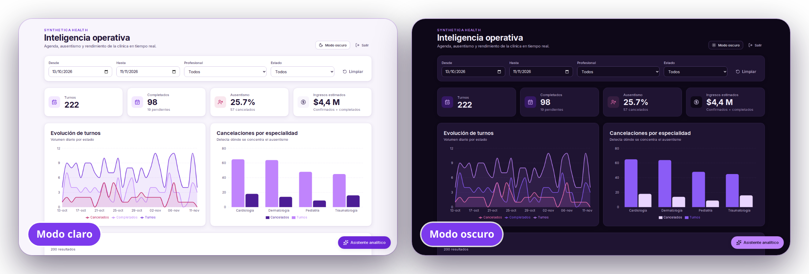

| Login | Mobile (modo oscuro) |
|---|---|
| 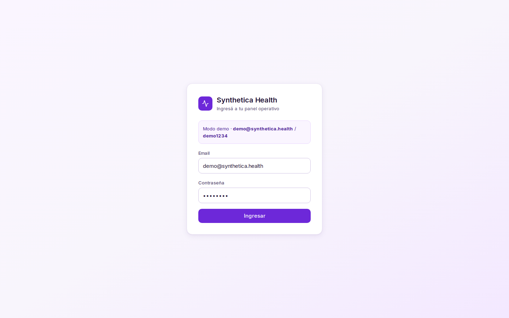 | 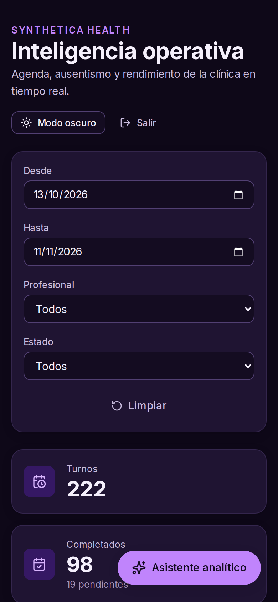 |

### Detalle con zoom

**KPIs con estados de carga y formato compacto** — React Query + skeletons SCSS
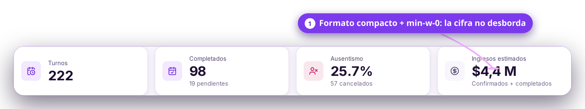

**Filtros avanzados por rango de fechas, profesional y estado** — sincronizados con la URL y leídos por el servidor (SSR)
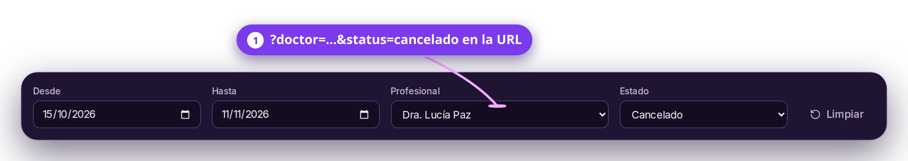

**Visualización de datos con Recharts** — colores tomados de los design tokens
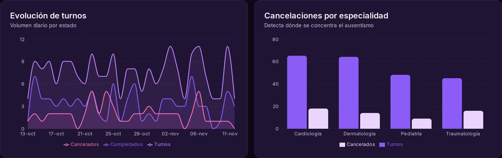

**Tabla accesible** — `caption`, `scope`, región desplazable con foco
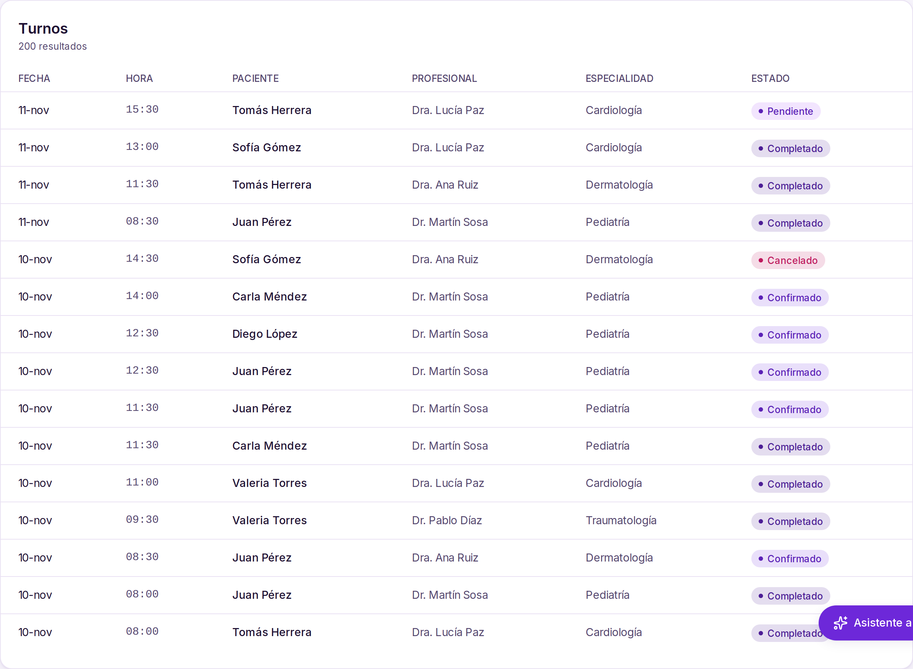

**Asistente analítico** — respuestas estructuradas (resumen, indicadores y tabla), historial con Zustand
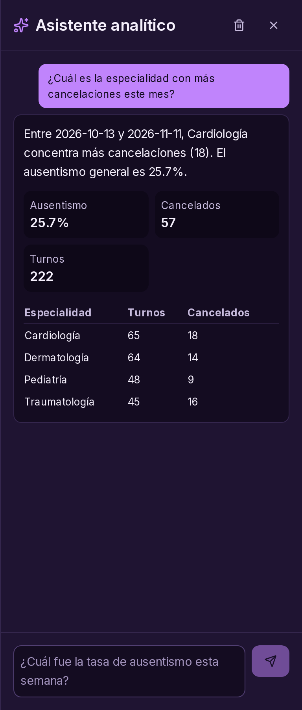

**Accesibilidad** — foco visible por teclado y error de validación anunciado con `role="alert"`
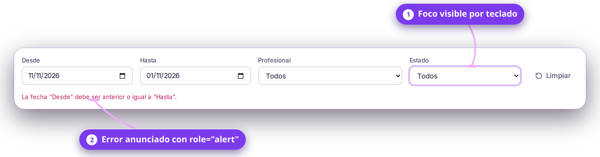

### Calidad y documentación

**Storybook** — componentes con controles interactivos y addon de accesibilidad
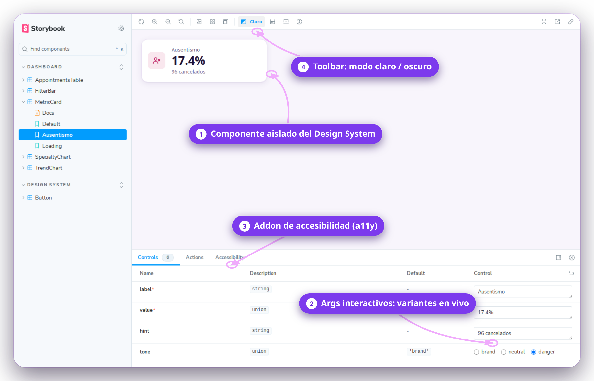

**Playwright** — flujos críticos E2E
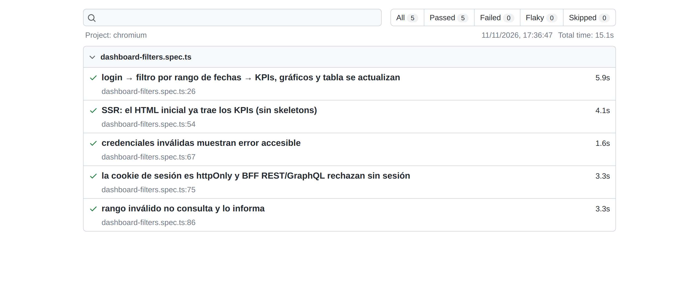

**Test E2E del flujo crítico**: login → filtro por rango de fechas → KPIs, gráficos y tabla actualizados (también tras recargar)
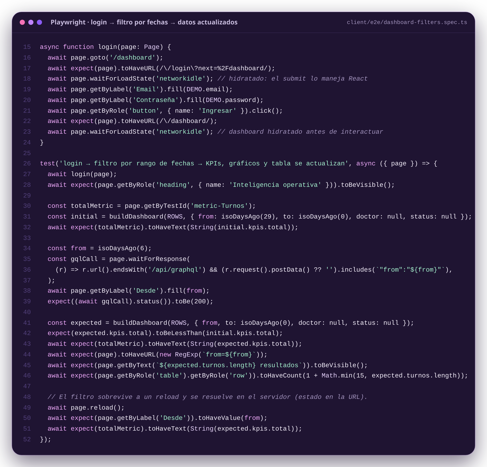

**Jest + React Testing Library** — cobertura
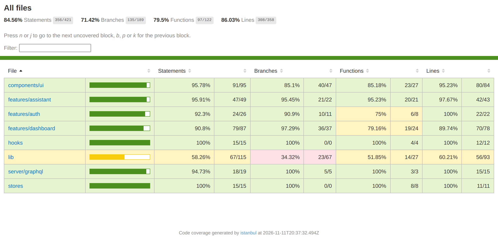

### Código

**TanStack Query + filtros sincronizados con la URL**
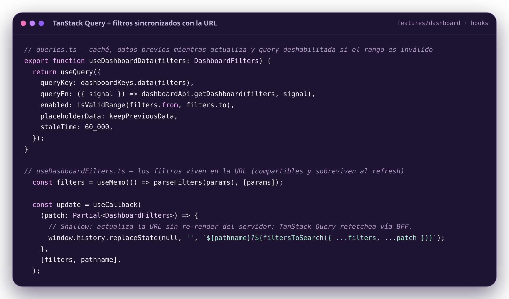

| SSR con Next.js | GraphQL |
|---|---|
| 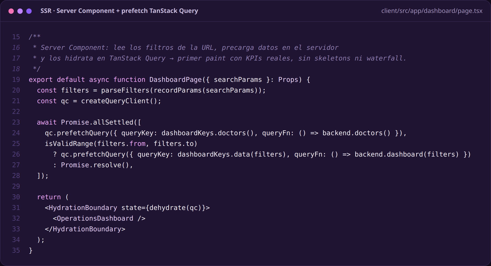 | 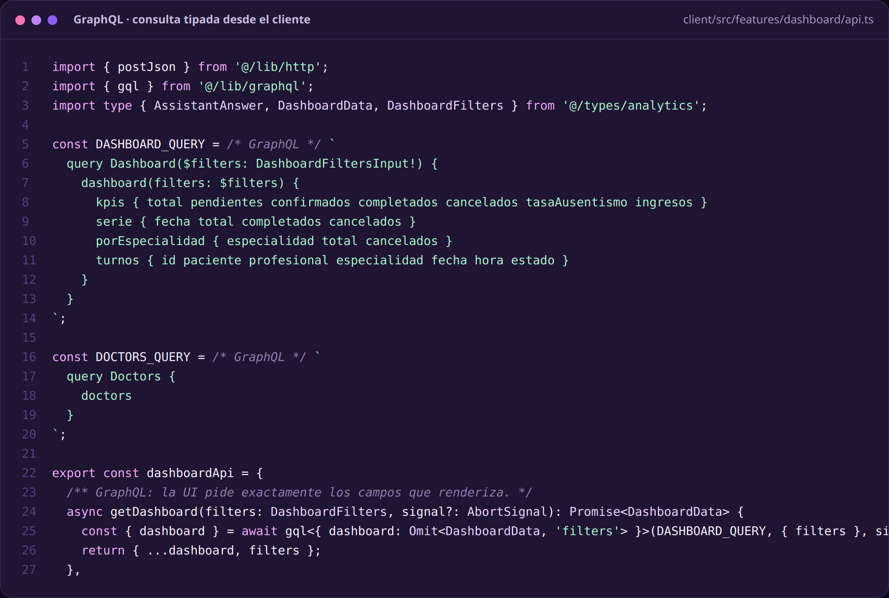 |
| **Test E2E del SSR** | **Zustand** |
| 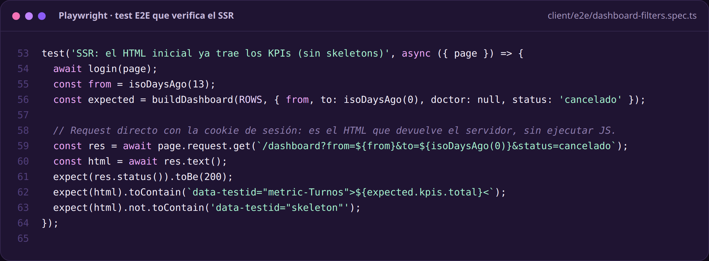 | 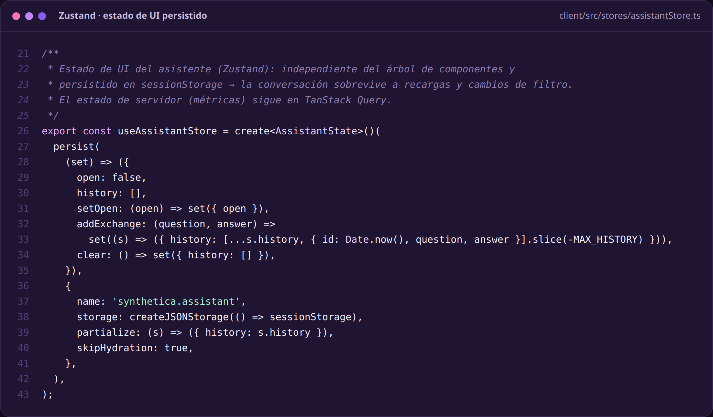 |

---

## Arquitectura

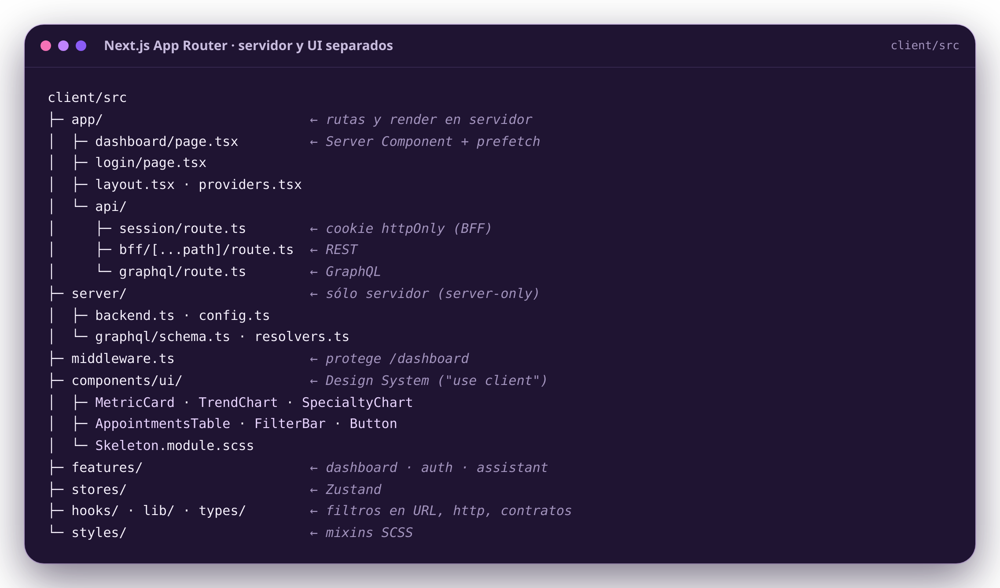

<details>
<summary>Árbol completo</summary>

```
client/src
├─ app/                  Next.js App Router: /login, /dashboard (Server Component), api/session, api/bff, api/graphql
├─ server/               Sólo servidor: config, acceso a la API, schema y resolvers GraphQL
├─ middleware.ts         Protege /dashboard por cookie de sesión
├─ components/ui/        Design system tipado (+ .stories.tsx, .test.tsx, .module.scss)
├─ features/
│  ├─ auth/              Login / logout
│  ├─ dashboard/         Página, queries (TanStack), api (GraphQL), agregación pura
│  └─ assistant/         Panel lateral del asistente analítico
├─ stores/               Zustand
├─ hooks/                useDashboardFilters (estado en URL)
├─ lib/                  http, graphql, filters, theme, queryClient
├─ styles/               Mixins SCSS
├─ mocks/                Dataset determinista (modo demo, Storybook, tests)
└─ types/                Contratos compartidos con la API
client/e2e/              Playwright
server/                  API Express: routes · services · validators (Zod)
```

</details>

### Flujo SSR

```
Navegador ──▶ middleware (cookie?) ──▶ /dashboard (Server Component)
                                         ├─ parseFilters(searchParams)
                                         ├─ prefetch TanStack Query ─▶ server/backend ─▶ API Express / modo demo
                                         └─ HydrationBoundary ─▶ HTML con KPIs ya renderizados
Filtros (cliente) ──▶ history.replaceState ──▶ useQuery ──▶ /api/graphql ──▶ API (JWT desde cookie httpOnly)
```

### Decisiones clave

- **SSR con prefetch hidratado**: el primer paint ya trae datos reales; los skeletons quedan sólo para cambios de filtro.
- **BFF**: el navegador nunca ve el JWT (cookie `httpOnly`, `sameSite=lax`, `secure` en producción).
- **Estado de servidor vs. estado de UI**: TanStack Query para métricas; Zustand para la conversación del asistente; la URL para los filtros.
- **GraphQL para lectura, REST para comandos**: el dashboard pide exactamente los campos que renderiza; el asistente es una operación.
- **Design tokens como variables CSS RGB**: un solo set de clases para ambos temas; Recharts y SCSS consumen los mismos tokens. Paleta púrpura, violeta, lila y morado.
- **Agregación pura** (`aggregate.ts`) espejo del SQL: alimenta el modo demo, Storybook y los tests con el mismo dataset.
- Ausentismo = turnos cancelados / total del rango.

### Contratos API

| Capa | Método | Ruta | Entrada | Salida |
|---|---|---|---|---|
| Next | POST/DELETE | `/api/session` | `{ email, password }` | cookie httpOnly |
| Next | POST | `/api/graphql` | `query Dashboard($filters)` / `query Doctors` | `DashboardData` / `string[]` |
| Next | GET/POST | `/api/bff/*` | REST | proxy a la API Express |
| Express | POST | `/api/login` | `{ email, password }` | `{ token, profesional }` |
| Express | GET | `/api/analytics/dashboard` | `from`, `to`, `doctor?`, `status?` | `DashboardData` |
| Express | POST | `/api/assistant/query` | `{ question, filters }` | `AssistantAnswer` |

---

## Scripts

```bash
# client
npm run dev            # modo demo (por defecto): demo@synthetica.health / demo1234
npm run dev:api        # contra la API real (server en :3001)
npm run typecheck
npm test               # Jest + React Testing Library
npm run test:coverage
npm run test:e2e       # Playwright (levanta Next en modo demo)
npm run storybook
npm run build && npm start

# server
npm run dev
```

**Cobertura**: Jest mide componentes, hooks, stores, GraphQL y librerías; las rutas de Next, el middleware y la capa de sesión se cubren con Playwright.

### Variables

- `client/.env`: `SYNTHETICA_DEMO` (`true` por defecto), `SYNTHETICA_API_URL`.
- `server/.env`: `DATABASE_URL`, `JWT_SECRET`, `CLIENT_ORIGIN`, `PORT` y la clave del asistente. Ver `server/.env.example`.

---

## Versión 2.0 — Próximas funcionalidades

**Producto**
- [ ] Alertas automáticas de pacientes en riesgo de ausentarse (recordatorios por WhatsApp y email).
- [ ] Analítica predictiva de ausentismo por franja horaria, especialidad y profesional.
- [ ] Reasignación sugerida de turnos libres para recuperar capacidad ociosa.
- [ ] Multi-sede y roles (dirección, recepción, profesional) con permisos por vista.
- [ ] Exportación de reportes a PDF y Excel desde el dashboard.
- [ ] Mapa de calor de ocupación por día y hora.

**Frontend**
- [ ] Streaming SSR con `Suspense` por sección y React Server Components para tablas grandes.
- [ ] Tabla virtualizada con paginación del lado del servidor, ordenamiento y columnas configurables.
- [ ] Internacionalización (es / pt / en) y formato regional de moneda y fechas.
- [ ] PWA con modo offline para recepción.
- [ ] Biblioteca de componentes publicada como paquete (npm) con versionado semántico.

**Calidad y plataforma**
- [ ] Pruebas de regresión visual (Chromatic / Playwright snapshots) y auditoría a11y automatizada en CI.
- [ ] CI/CD con GitHub Actions: typecheck, Jest, Playwright y build en cada PR.
- [ ] Deploy en Azure Static Web Apps y monitoreo con Application Insights.
- [ ] Métricas de Web Vitals (LCP, INP, CLS) y presupuestos de performance.
- [ ] GraphQL con subscriptions para actualizar el dashboard en tiempo real.

---

**Autoría:** Virginia Alejandra Ponce
